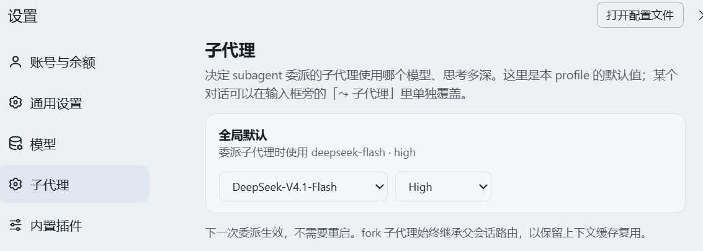

# dsh-subagent-models

Set the **provider, model and reasoning effort** that DeepSeek Harness subagents run with —
**one setting, one place to change it**. The composer shows a read-only badge with the value
that will actually be used, so the conversation never contradicts the setting.

为 DeepSeek Harness 的子代理统一指定**用哪个模型、思考强度多深**：只有一个设置入口（设置 › 子代理），
输入框旁只显示"当前生效值"，不再有第二个设置位置，也不会出现"设置了却没生效"。

- Host half: route store + `agent/request` override (`index.js`)
- Web half: one settings page + a read-only composer badge (`client.js`)
- No runtime dependency on dsh packages; no build step.

---

## Screenshots / 截图



## Install / 安装

```bash
# npm
dsh plugin --profile <profile> add dsh-subagent-models

# or straight from this repository
dsh plugin --profile <profile> add github:Garybot126/dsh-subagent-models
```

Then restart dsh once if the plugin row was not hot-loaded.

## What it does / 做什么

| Where | What |
|---|---|
| Settings → 子代理 | **The only editor**: provider / model / reasoning effort |
| Composer → 「⤳ 子代理 …」 | **Read-only** badge: the route every new delegation will use |

Both are driven by the live LLM catalog (`ctx.llm`): models are grouped by provider, and the
effort list is the one **that model** advertises (`resolveModelInfo().reasoning.efforts`), so an
unsupported level is never offered.

## When it takes effect / 什么时候生效

- A change applies to the **next delegation** — no restart, no new conversation.
- A child that is already running picks it up on its **next model request**.
- With no route configured, children keep inheriting the parent session's route — exactly the
  behaviour of not installing the plugin.

## How the route is applied / 怎么生效

The delegation tool (`subagent`) is composed in the **agent-plane preset**, not in the Profile
patch, and it carries its own static `agentOptions`. A plugin cannot rewrite that composition,
so the route is applied one level lower:

```
agent/request  (waterfall: "replace the frozen call configuration")
```

The listener is registered once and only rewrites an Agent that another live Agent owns — a
delegated child. A top-level Session is never touched. Consequences:

- works with the official `subagent` tool, without editing the preset and without adding
  model-selection parameters to the tool schema;
- `subagent`, `subagent_fork` and Agent Teams members all count as delegated agents.

## Data / 数据

`$DSH_HOME/plugin-data/subagent-models.json` (falls back to `~/.dsh/plugin-data/`), hot-reloaded
on mtime, so editing it by hand also works:

```json
{
  "version": 1,
  "global": {
    "default": { "provider": "deepseek-official", "model": "deepseek-flash", "effort": "high" },
    "presets": {}
  },
  "sessions": {}
}
```

`global.default: null` means "no route configured". Older builds allowed a per-conversation
override; on first load such a file is copied to `subagent-models.sessions.bak-<time>.json` and
those overrides are dropped, because a forgotten per-conversation value silently shadowing the
global default was exactly the inconsistency this plugin now avoids.

Capability disclosure: reads and writes this one JSON file (plus its one-time backup); binds no
network port beyond the loopback HTTP prefix `/plugin/subagent-models` used by the Web UI; never
reads conversation content, credentials, or any other file.

## Limits / 限制

- `subagent_fork` children are overridden too. A fork shares the parent's prefix, so a different
  model costs its KV cache; leave the route empty (or keep the preset's own `agentOptions`) if
  that matters to you.
- An effort the chosen model does not support fails the adapter's validation — the plugin never
  silently downgrades.
- The override is per request. Context-window and metering metadata follow the effective route,
  while the child's creation options keep the preset's values.

## Relationship to similar plugins / 与同类插件的关系

Several plugins in the market move subagent routing: `dsh-subagent-custom` (task-class routing
through `agent/request`), `dsh-subagent-model-picker` (a per-session picker),
`dsh-subagent-default-model` (settings.yaml default), `dsh-model-settings` (a settings panel),
`dsh-orquestrator` (a fixed forced route). This one deliberately keeps the smallest surface: no
task classification, no per-conversation layer, no extra model-facing parameters, no preset
editing — one setting, applied at one override point, with the effective value visible in the
composer.

## Verified / 已验证

On dsh 0.2.1-rc.2 (desktop profile):

- an invalid model id in the store → the child failed; a real different route
  (`deepseek-v4-pro` + `max`) → the child succeeded, so the global value reaches the child;
- `GET /plugin/subagent-models/state` → 200 with the catalog (4 providers / 8 routes);
- `POST /plugin/subagent-models/route` → 200 and the JSON file updates on disk;
- the settings section and the composer badge register as active slot occupants;
- with 8 legacy per-conversation overrides in the file, the migration copied them to
  `subagent-models.sessions.bak-*.json` and reset `sessions` to `{}`.

## License

MIT © Gary Gai
